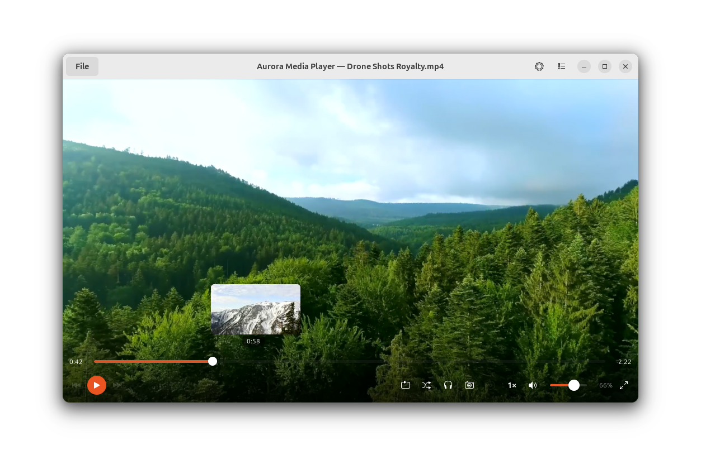
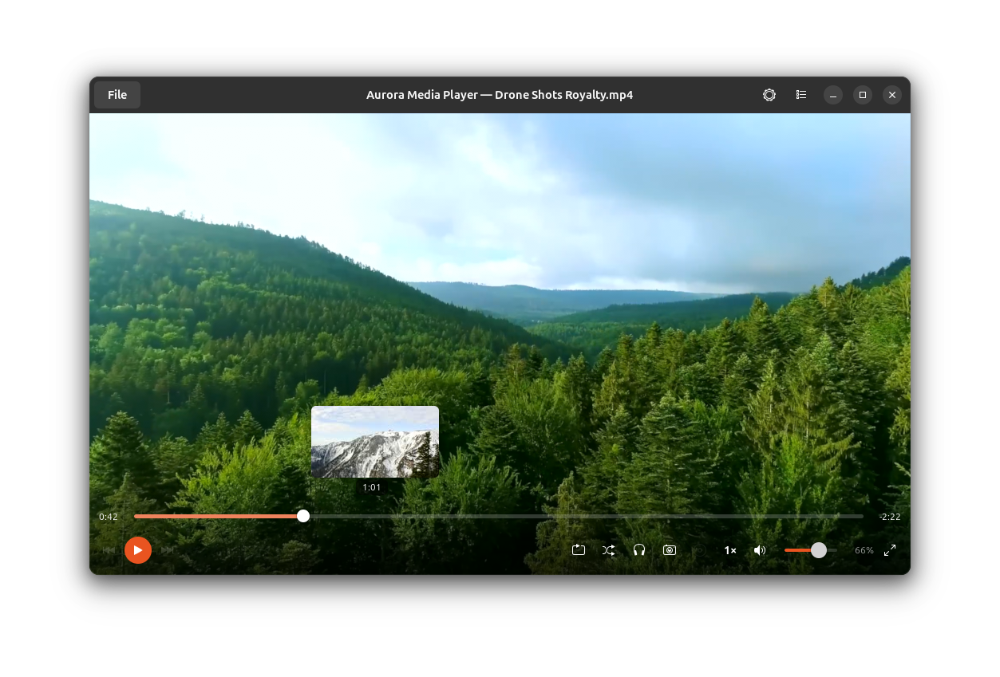
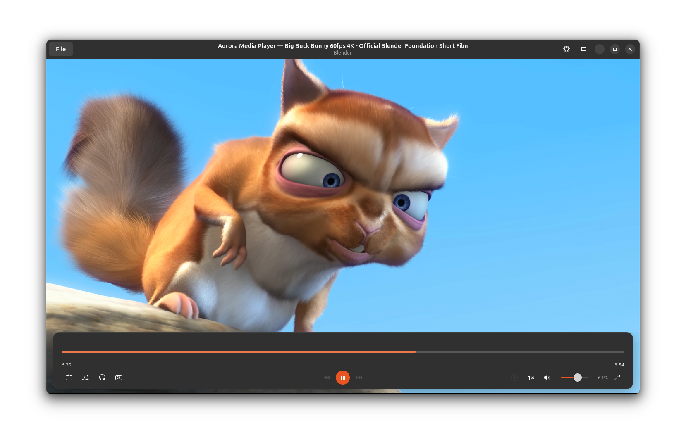
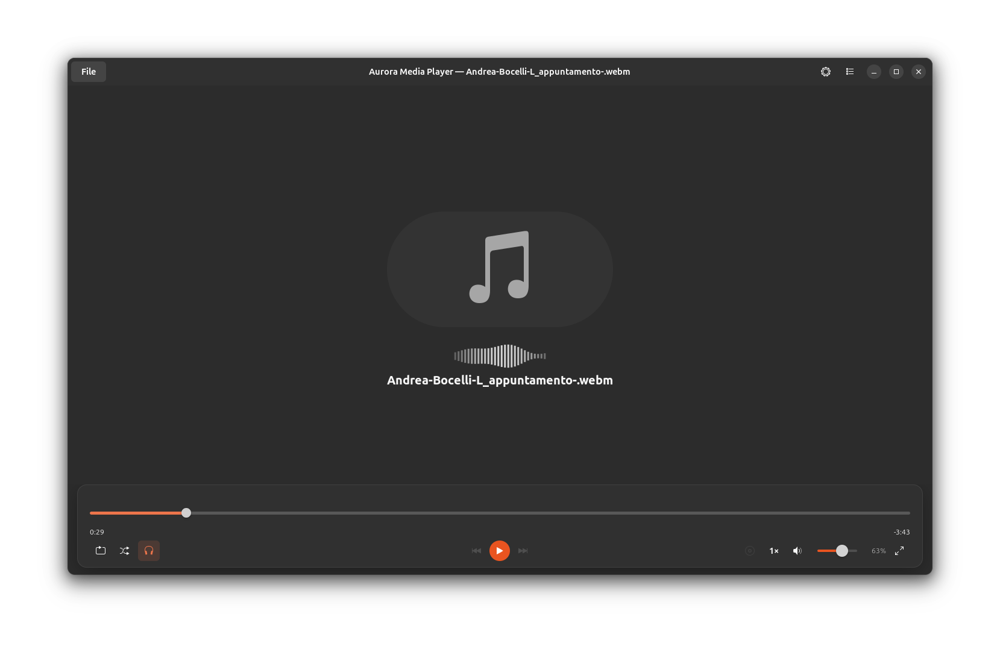

# Aurora Media Player

A modern media player for GNOME, built with Rust, GTK4, libadwaita, and mpv.


<a href="https://flathub.org/apps/io.github.daniacosta_dev.AuroraMediaPlayer"></a>



## Screenshots

| Dark theme | Floating controls | Music |
| --- | --- | --- |
|  |  |  |

## Features

**Playback**
- Video and audio in all common formats (mp4, mkv, avi, mp3, flac, ogg, and more)
- Hardware-accelerated decoding via VA-API
- URL playback — paste any YouTube, Twitch, or direct media URL (powered by yt-dlp)
- Adjustable playback speed (0.25× – 2×)
- Screenshot capture (video only)

**Playlist**
- File playlist with drag-and-drop reordering
- URL playlists — add multiple URLs, save them by name and reload later
- Repeat modes: none, repeat playlist, repeat one

**Interface**
- Fullscreen mode with auto-hiding controls and cursor
- Controls auto-hide after 2 seconds of mouse inactivity
- Audio-only view with artist, album, and track title from file metadata
- Light / Dark / Follow system theme — persisted across sessions
- MPRIS support — media keys, taskbar and lock screen integration

**Other**
- Session restore — remembers the last played file and position
- yt-dlp bundled in the Flatpak and Snap packages (no manual installation needed)

## Installation

### Flathub (recommended)

<a href="https://flathub.org/apps/io.github.daniacosta_dev.AuroraMediaPlayer"></a>

```bash
flatpak install flathub io.github.daniacosta_dev.AuroraMediaPlayer
flatpak run io.github.daniacosta_dev.AuroraMediaPlayer
```

### Snap

```bash
sudo snap install aurora-media-player
```

### Build from source

**Dependencies**

```bash
# Ubuntu / Debian
sudo apt install libmpv-dev libgtk-4-dev libadwaita-1-dev pkg-config

# Arch
sudo pacman -S mpv gtk4 libadwaita pkg-config
```

**Build**

```bash
git clone https://github.com/daniacosta-dev/aurora-media-player
cd aurora-media-player
cargo build --release
cargo run --release
```

## Architecture

```
app/src/
├── main.rs           Entry point, resource loading
├── app.rs            GtkApplication / AdwApplication setup
├── mpris.rs          MPRIS D-Bus server (media keys, taskbar)
├── state.rs          Shared playback state
├── player/
│   ├── mpv.rs        libmpv wrapper and command execution
│   └── pipeline.rs   PlayerCommand / PlaybackState / RepeatMode
└── ui/
    ├── window.rs     AdwApplicationWindow, layout, event loop
    ├── headerbar.rs  Header bar, file/URL dialogs, settings
    ├── controls.rs   Seek bar, playback buttons, volume
    ├── video_area.rs OpenGL drawing area for mpv rendering
    └── playlist.rs   Sidebar playlist panel
```

## Roadmap

- [ ] Subtitle track selection
- [ ] Audio and video track switching
- [ ] Recent files history
- [ ] Playlist import / export (M3U, PLS)
- [ ] Chapter navigation

## Contributing

Contributions are welcome. Feel free to open issues or pull requests.

---

If you find Aurora useful, consider [⭐ starring the repository](https://github.com/daniacosta-dev/aurora-media-player) — it helps a lot!

## License

[GPL-3.0](LICENSE) — required by the libmpv dependency.

Made with ❤️ and Rust · MIT License · [Ko-fi](https://ko-fi.com/daniacostadev)
Created by [@daniacosta-dev](https://github.com/daniacosta-dev)